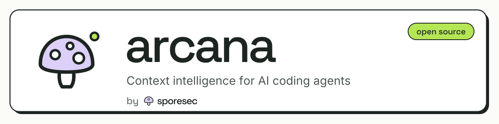

<p align="center">
  
</p>

<p align="center">
  <strong>Context intelligence for AI coding agents.</strong><br/>
  22 focused, tested skills and a CLI that loads only what your project needs. By <a href="https://sporesec.com">SporeSec</a>.
</p>

<p align="center">
  <a href="https://www.npmjs.com/package/@sporesec/arcana"></a>
  <a href="LICENSE"></a>
  <a href="https://github.com/mahdy-gribkov/arcana/actions/workflows/ci.yml"></a>
  <a href="#skills"></a>
</p>

---

## What it does

Every skill an agent has installed costs context on every turn. Load all of them and the context bloats; load none and
the agent does not know your stack. Arcana installs skills and then curates which ones load, based on your project,
your token budget and your usage.

Each skill is a `SKILL.md` with job-first triggers, references for the detail, tested scripts where a step is
mechanical, and eval cases that check the skill fires when it should and stays quiet when it should not.

## Install

Pick one:

```bash
# Claude Code plugin marketplace
claude plugin marketplace add mahdy-gribkov/arcana

# Any agent, via skills.sh
npx skills add mahdy-gribkov/arcana

# The Arcana CLI (curation, compression, memory)
npm i -g @sporesec/arcana
```

Then, in a project:

```bash
arcana init          # detect the project, scaffold agent config, suggest skills
arcana install go-dev testing security-review
arcana curate        # write _active.md: the relevant skills that fit your budget
```

Skills install to `~/.agents/skills/`.

## The CLI

```bash
arcana curate --model gpt-5.4 --budget 40     # 40% of that model's context
arcana curate --include go-dev ts-dev          # force-include skills
arcana compress git status                     # strip noise from tool output
arcana compress npm test                       # keep failures and the summary
arcana remember "use vitest, not jest"         # memory that survives sessions
arcana recall vitest
arcana mcp install context7                    # add an MCP server to your agent config
arcana index && arcana load go-dev             # tiny index first, full skill on demand
```

| Group | Commands |
|-------|----------|
| Getting started | `init`, `doctor [--fix]` |
| Skills | `list`, `search`, `info`, `install`, `update`, `uninstall`, `recommend` |
| Context | `curate`, `compress`, `remember`, `recall`, `forget`, `mcp`, `index`, `load` |
| Security | `scan [--all]`, `verify [--all]`, `lock [--ci]` |
| Development | `create`, `validate [--all --fix --cross]`, `audit` |
| Inspection | `diff`, `outdated` |
| Configuration | `config`, `providers`, `clean` |
| Workflow | `export`, `import`, `completions` |

Every command supports `--json` and respects `NO_COLOR`. `arcana <command> --help` shows the options.

## Skills

| Category | Skills |
|----------|--------|
| Code quality and review | `codebase-analysis`, `testing`, `git-workflow`, `performance-optimization`, `design-doc` |
| Security | `security-review`, `bugbounty-report`, `oauth-auth` |
| Languages and frameworks | `ts-dev`, `go-dev`, `python-best-practices`, `nextjs-16`, `tailwind-css` |
| APIs, data and AI | `api-design`, `database-design`, `llm-integration`, `scraping-automation` |
| Infrastructure | `docker-kubernetes`, `ci-cd-pipelines` |
| Web quality | `accessibility-wcag`, `i18n-localization`, `seo-meta` |

Version 5 cut the library from 74 broad skills to these 22 deep ones. The removed skills (game development, mobile,
cloud vendors and others) remain in the git history at tag `v4.0.0`.

## Compatibility

Skills are plain markdown with YAML frontmatter. Claude Code loads them natively; `arcana init` scaffolds the config
that points other agents at them.

| Agent | Config file |
|-------|-------------|
| Claude Code | `CLAUDE.md` (plus native skill loading) |
| Codex CLI | `AGENTS.md` |
| Cursor | `.cursor/rules/` |
| Gemini CLI | `GEMINI.md` |
| Windsurf | `.windsurfrules` |
| Antigravity | `AGENT.md` |
| Aider | `.aider.conf.yml` |

## Quality gates

`pnpm run ci` in `cli/` runs what CI runs: lint, format, types, tests with coverage, build, then
`scripts/check-skills.sh` (strict YAML frontmatter, a "Use when" trigger, a 500-line cap, licence and version
checks, the audit score floor, every skill script test) and `scripts/security-scan.sh`. The manifest passes
`claude plugin validate . --strict`.

## Acknowledgments

| Project | What it shaped |
|---------|----------------|
| [skills.sh](https://skills.sh) | Skill discovery and install patterns |
| [token-optimizer](https://github.com/alexgreensh/token-optimizer) | Token budgets, progressive disclosure, backup-first safety |
| [RTK](https://github.com/rtk-ai/rtk) | The tool-output compression pipeline |
| [mem0](https://github.com/mem0ai/mem0) | Cross-session memory |
| [Context7](https://github.com/upstash/context7) | The MCP server for live documentation |

## Contributing, security, contact

- [CONTRIBUTING.md](CONTRIBUTING.md)
- Report vulnerabilities via [SECURITY.md](SECURITY.md).
- Mahdy Lorens Gribkov, [SporeSec](https://sporesec.com), [GitHub](https://github.com/mahdy-gribkov)

## License

[Apache 2.0](LICENSE). See [NOTICE](NOTICE).
