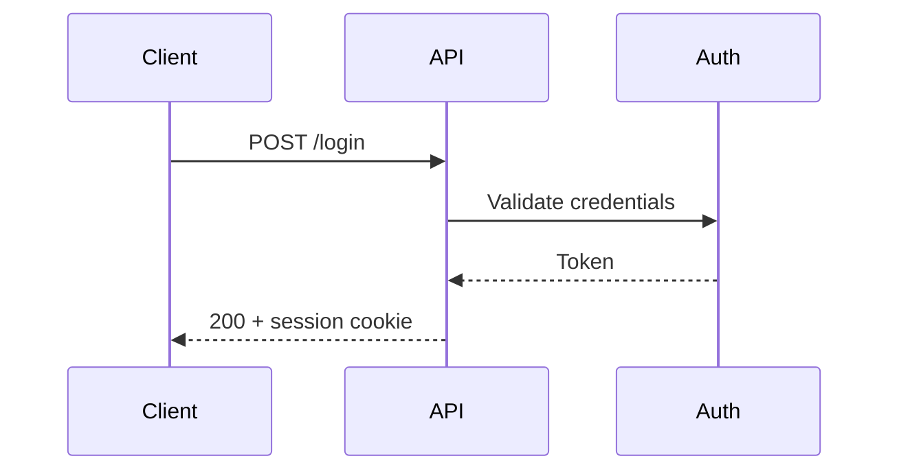
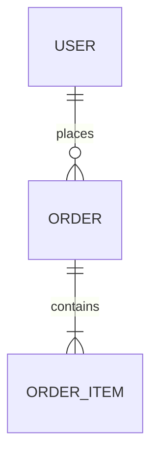

# Requirements, task breakdown and lighter documentation

Contents: when to use this, requirements with acceptance criteria, task breakdown, API contract docs, Mermaid diagrams.

The design note answers "should we build this, and how". This file covers the neighbouring jobs: pinning requirements before the note, splitting an accepted design into tasks, and documenting an API or a small flow without the Excalidraw builder.

## Requirements with acceptance criteria

Write the requirement so a test can fail it. Mark every unclear point `[NEEDS CLARIFICATION]` and resolve each before the note is accepted: ambiguity is a defect in the spec, not a detail for the implementer.

Weak:

```markdown
- Users should be able to log in
- Make it secure
```

Strong:

```markdown
### User stories
- As a returning user, I can log in with email and password so I reach my data.

### Acceptance criteria
1. Login rate-limits to 5 attempts per 15 minutes per IP.
2. Sessions expire after 24h idle and 7d absolute.
3. Every auth endpoint returns the same error shape: `{ error: string, code: string }`.

### Out of scope
- Social login (separate spec).

### Open questions
- [NEEDS CLARIFICATION] Session storage: cache-backed or database-backed?
```

Research unknowns before committing to a design, and write contracts and tests before the implementation they constrain.

## Task breakdown

After the decision is accepted, split the work into tasks of a few hours each. Name the dependency of each task, and mark tasks that can run in parallel with `[P]`.

```markdown
### Track A: data layer [P]
- A1. Migration: `dashboard_widgets` table
- A2. Seed development data

### Track B: API [P] (depends: A1)
- B1. `GET /api/dashboard`
- B2. Contract tests for B1

### Track C: integration (depends: B1)
- C1. Wire the API to the UI
- C2. End-to-end test: load, rearrange, save
```

Each task names the invariant or test from the design note that proves it.

## API contract docs (OpenAPI)

When the change adds or alters an HTTP API, generate the spec from annotated code where the framework supports it (tsoa or NestJS for TypeScript, swaggo for Go, FastAPI for Python), then lint it:

```bash
npx @stoplight/spectral-cli lint openapi.yaml
```

Require a summary, a description, a tag and a response example on every operation. A spec with bare summaries is not documentation. Link the spec file from the note's Evidence section so the contract is reviewable next to the decision.

## Mermaid for small flows

For a single flow or a data model, a Mermaid block renders natively on GitHub and GitLab and needs no build step. Use the Excalidraw builder (`diagram-guide.md`) when the design spans several components and needs a defect-checked layout or step-by-step focus images.





Render a static image with `npx @mermaid-js/mermaid-cli -i diagram.mmd -o diagram.svg`. Keep the `.mmd` source beside the image and link both from the note's Diagram section.
